<!-- ===================== ANIMATED HEADER ===================== -->
<div align="center">


<a href="https://github.com/Gatil1616/Healthcare-Readmission-Analysis">
  
</a>

<br/>


</div>

---

## 📑 Table of Contents

- [🎯 Project Overview](#-project-overview)
- [📊 Key Results at a Glance](#-key-results-at-a-glance)
- [🗂️ Dataset](#️-dataset)
- [🔄 Project Workflow](#-project-workflow)
- [🛠️ Tools & Technologies](#️-tools--technologies)
- [🖼️ Project Screenshots](#️-project-screenshots)
- [🔍 Key Insights](#-key-insights)
- [🤖 Modeling & Performance](#-modeling--performance)
- [💰 Business Impact (Hypothetical)](#-business-impact-hypothetical)
- [✅ Recommendations](#-recommendations)
- [⚠️ Limitations & Future Work](#️-limitations--future-work)
- [📁 Repository Structure](#-repository-structure)
- [🚀 How to Run](#-how-to-run)
- [👤 Author](#-author)

---

## 🎯 Project Overview

Hospital readmissions within 30 days of discharge are costly for hospitals and risky for patients. This project is an **end-to-end analytics pipeline** that:

1. Downloads and audits a real-world clinical dataset
2. Cleans and engineers clinically meaningful features
3. Explores patterns behind readmissions
4. Trains machine-learning models to **predict 30-day readmission**
5. Translates model output into a **patient risk-stratification framework** and a **cost-benefit analysis**

> **Goal:** Help hospitals identify high-risk diabetic patients *before* discharge so that follow-up care can be targeted where it matters most.

---

## 📊 Key Results at a Glance

<div align="center">

| 🏥 Admissions Analysed | 🔁 30-Day Readmission Rate | 🌲 Best Model | 📈 ROC AUC | 🎯 Very High Risk Group Readmits |
|:---:|:---:|:---:|:---:|:---:|
| **101,766** | **11.16%** | **Random Forest** | **0.653** | **41.5%** |

</div>

---

## 🗂️ Dataset

| Property | Details |
|---|---|
| **Name** | Diabetes 130-US Hospitals for Years 1999–2008 |
| **Source** | [UCI Machine Learning Repository](https://archive.ics.uci.edu/ml/datasets/diabetes+130-us+hospitals+for+years+1999-2008) |
| **Records** | 101,766 hospital encounters |
| **Original Features** | 50 (demographics, diagnoses, medications, utilization) |
| **Target** | `readmitted` → converted to binary: `<30 days = 1`, otherwise `0` |
| **Class Imbalance** | ~7.96 : 1 (88.84% not readmitted vs 11.16% readmitted) |

The notebook downloads the dataset automatically if it isn't found locally.

---

## 🔄 Project Workflow

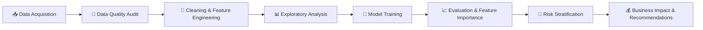

<details>
<summary><b>🧹 Data cleaning & feature engineering steps (click to expand)</b></summary>

- Replaced `?` placeholders with proper `NaN` values
- Dropped low-value / high-missing columns: `encounter_id`, `patient_nbr`, `weight` (96.9% missing), `payer_code` (39.6%), `medical_specialty` (49.1%)
- Filled missing `race` and `diag_1/2/3` values with `Unknown`
- Created binary target `readmitted_binary` (`<30` → 1, else 0)
- Grouped ICD-9 diagnosis codes into clinical categories (Circulatory, Respiratory, Digestive, Diabetes, Injury, Genitourinary, Musculoskeletal, Neoplasms, Other)
- Converted age ranges (e.g. `[70-80)`) into numeric midpoints (`age_numeric`)
- Label-encoded categorical variables and scaled features with `StandardScaler`
- Used a stratified 80/20 train-test split (random seed 42)

</details>

---

## 🛠️ Tools & Technologies

<div align="center">


</div>

| Category | Tools |
|---|---|
| **Language** | Python |
| **Data Manipulation** | Pandas, NumPy |
| **Visualization** | Matplotlib, Seaborn |
| **Machine Learning** | Scikit-learn (Logistic Regression, Random Forest, StandardScaler, LabelEncoder) |
| **Evaluation** | Confusion Matrix, ROC-AUC, Precision, Recall, F1-Score |
| **Environment** | Jupyter Notebook |
| **Version Control** | Git & GitHub |

---

## 🖼️ Project Screenshots

### 🏆 Final Analytics Dashboard

<div align="center">
  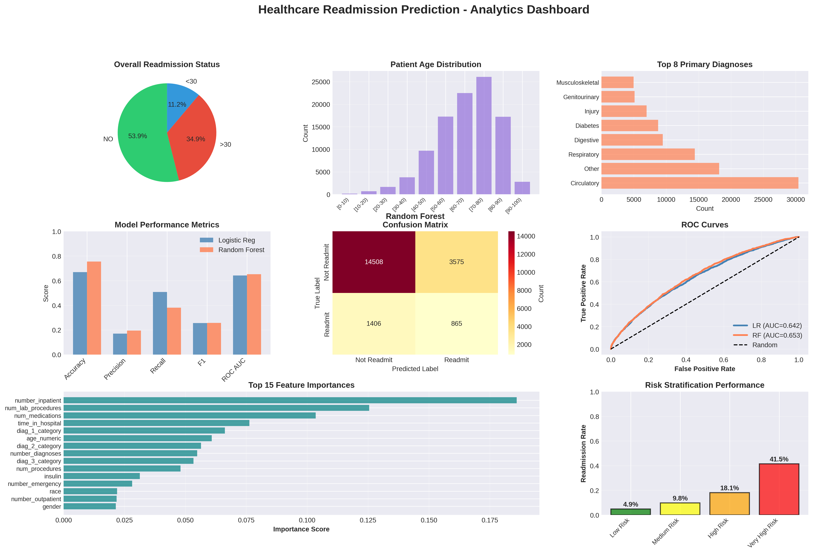
  <p><i>One-glance summary: readmission status, age distribution, top diagnoses, model metrics, confusion matrix, ROC curves, feature importance and risk stratification.</i></p>
</div>

---

### 🎯 Target Variable Distribution

<div align="center">
  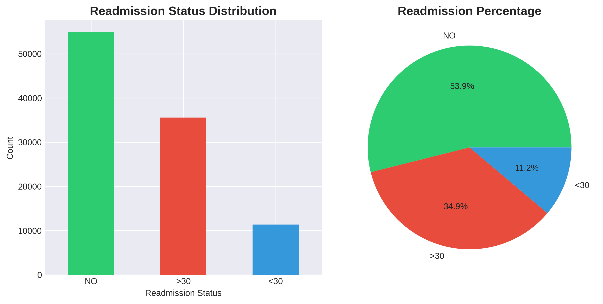
  <p><i>Only 11.16% of patients were readmitted within 30 days, so this is an imbalanced classification problem.</i></p>
</div>

---

### 🔗 Correlation Analysis

<div align="center">
  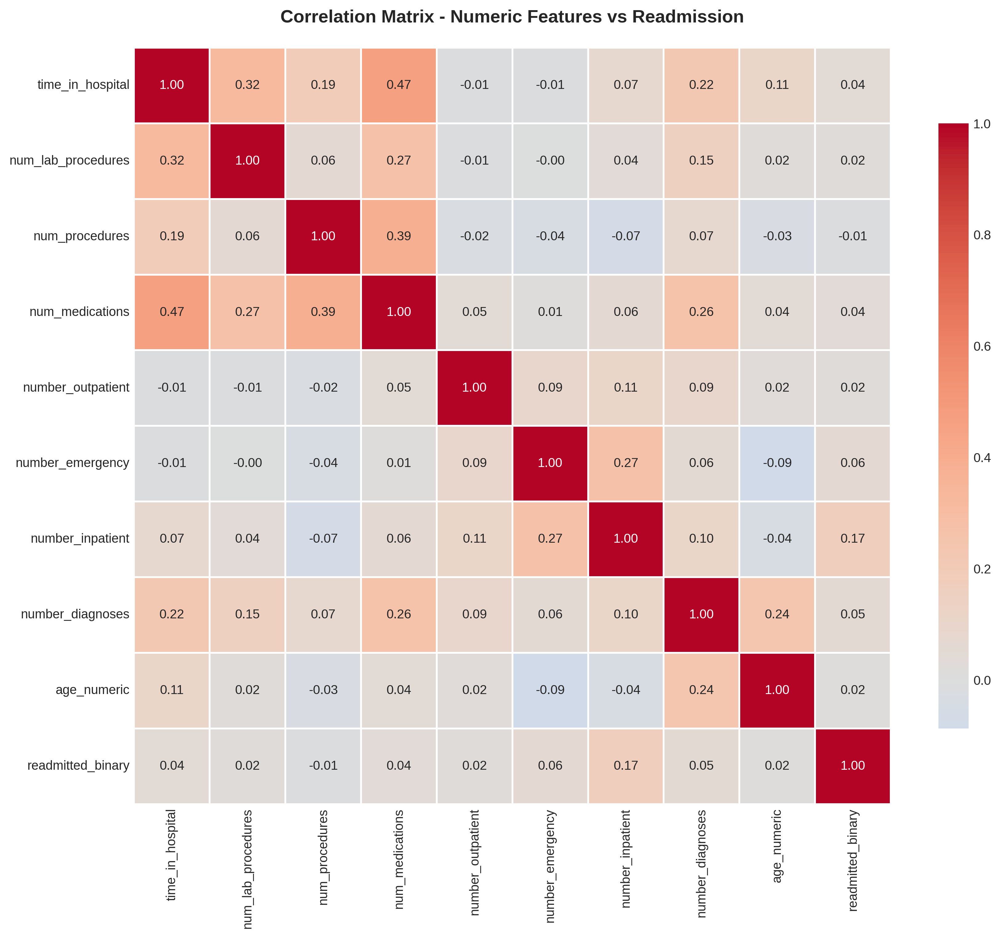
  <p><i><code>number_inpatient</code> (prior inpatient visits) shows the strongest correlation with readmission (0.165).</i></p>
</div>

---

### 📊 Numeric Features vs Readmission

<div align="center">
  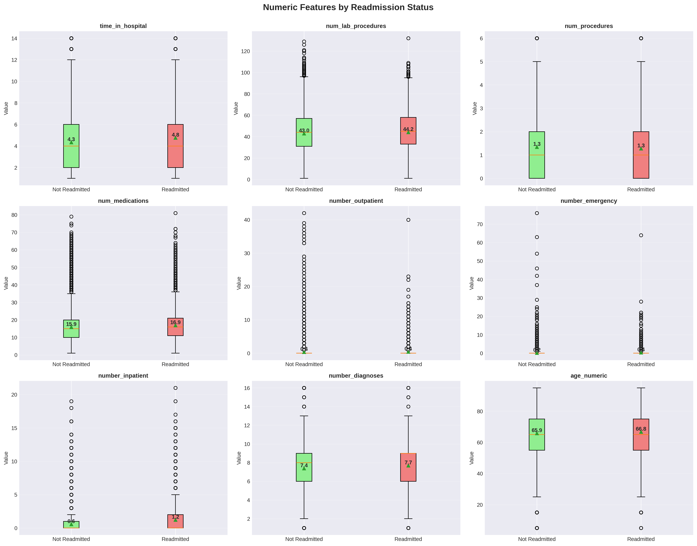
</div>

---

### ⚖️ Model Comparison

<div align="center">
  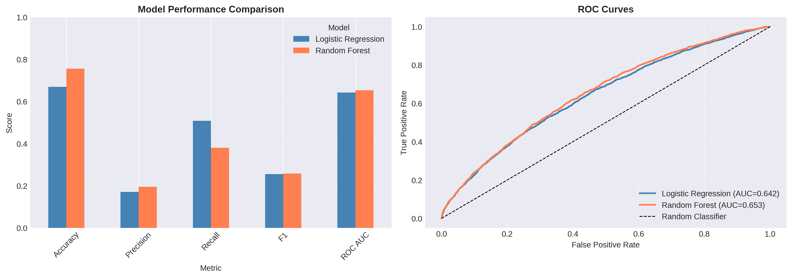
  <p><i>Logistic Regression (baseline) vs Random Forest across accuracy, precision, recall, F1 and ROC-AUC.</i></p>
</div>

---

### 🧮 Confusion Matrices

<div align="center">
  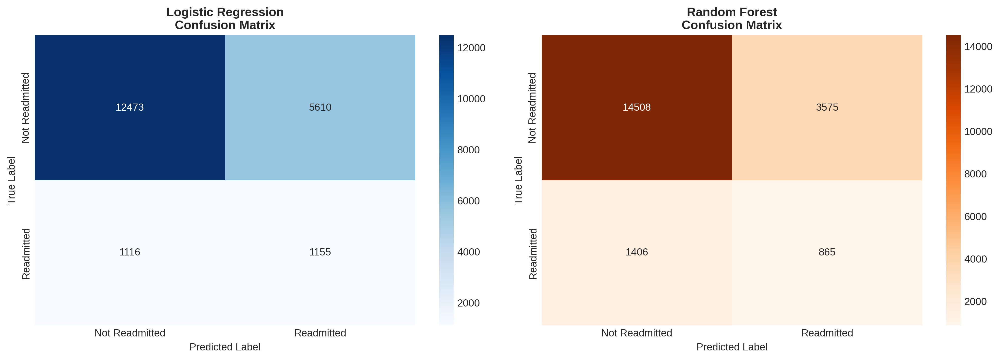
</div>

---

### 🌟 Feature Importance

<div align="center">
  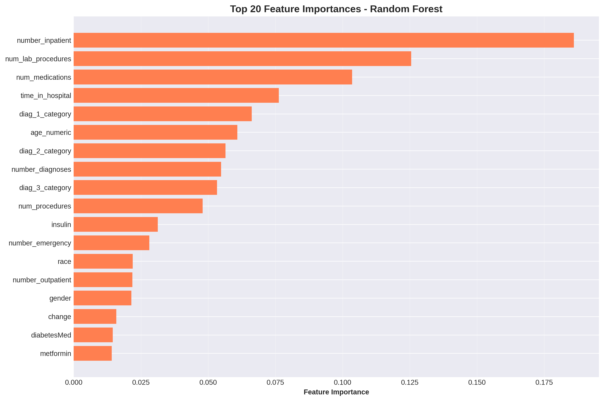
  <p><i>Prior inpatient admissions, lab procedures and medication count are the most influential predictors.</i></p>
</div>

---

### 🚦 Patient Risk Stratification

<div align="center">
  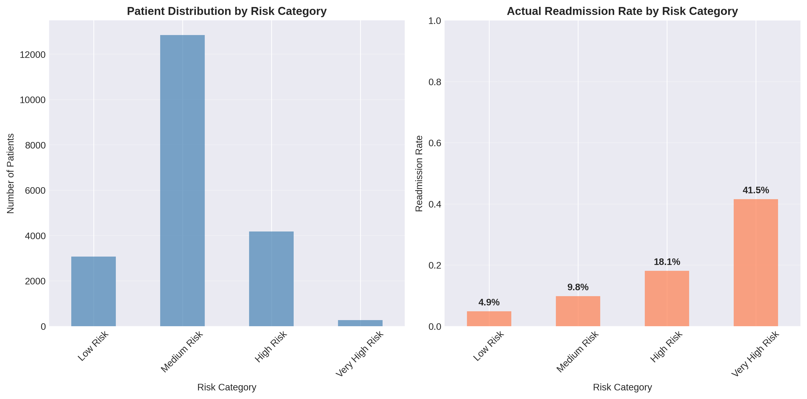
  <p><i>Readmission rate climbs from 4.9% (Low Risk) to 41.5% (Very High Risk).</i></p>
</div>

<details>
<summary><b>📂 More visualizations (click to expand)</b></summary>

<br/>

**Numeric Distributions**

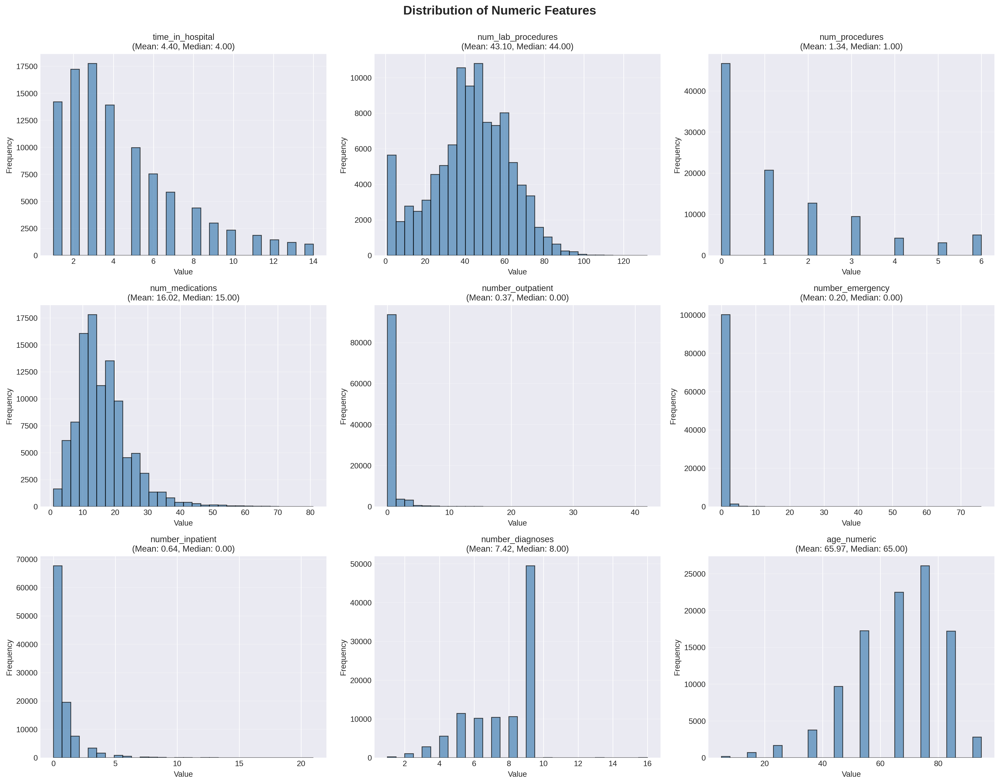

**Categorical Distributions**

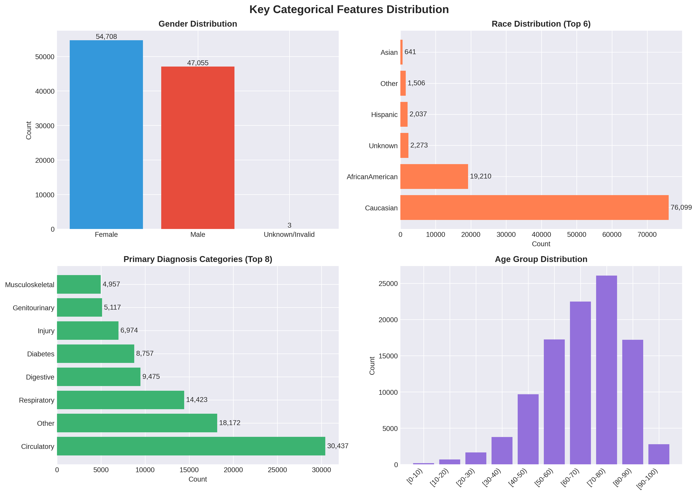

**Categorical Features vs Readmission**

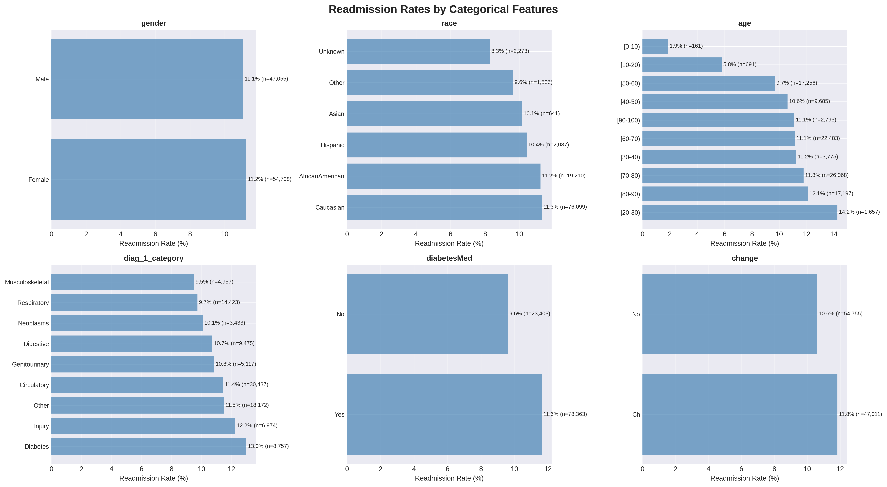

**Prediction Probability Distribution**

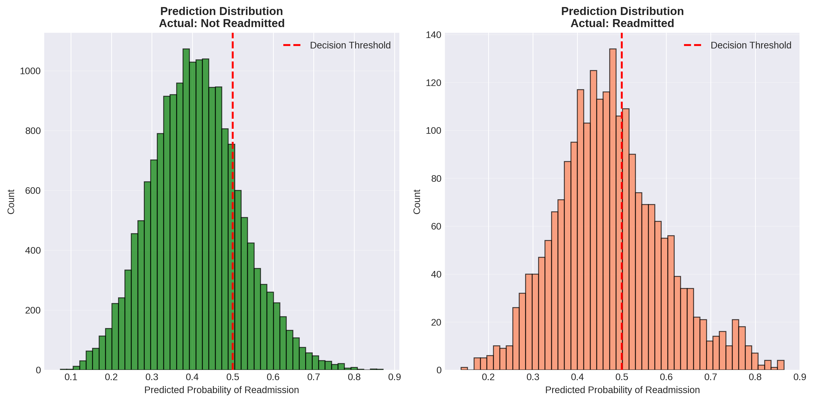

</details>

---

## 🔍 Key Insights

- 🏥 **Prior inpatient visits are the #1 signal.** Readmitted patients averaged **1.22** prior inpatient visits vs **0.56** for others (about +118%).
- 🚑 **Emergency visits double the risk signal.** Readmitted patients averaged **0.36** emergency visits vs **0.18** (about +101%).
- ⏱️ Readmitted patients stayed longer (**4.77 vs 4.35 days**) and received more medications (**16.9 vs 15.9**).
- 👴 The population is largely elderly: median age is 65 and **67.4%** of patients are over 60.
- ❤️ **Circulatory conditions** are the most common primary diagnosis (30,437 encounters), followed by respiratory and digestive conditions.
- 🧪 Data quality matters: `weight` was ~97% missing and `medical_specialty` ~49% missing, so both were dropped.

---

## 🤖 Modeling & Performance

Two models were trained on 81,412 records and tested on 20,354 unseen records.

| Model | Test Accuracy | Precision | Recall | F1-Score | ROC-AUC |
|---|:---:|:---:|:---:|:---:|:---:|
| Logistic Regression (class-weighted baseline) | 0.6695 | 0.1707 | **0.5086** | 0.2556 | 0.6425 |
| **Random Forest** (100 trees) | **0.7553** | **0.1948** | 0.3809 | **0.2578** | **0.6529** |

**Random Forest confusion matrix (test set)**

| | Predicted: Not Readmitted | Predicted: Readmitted |
|---|:---:|:---:|
| **Actual: Not Readmitted** | 14,508 (TN) | 3,575 (FP) |
| **Actual: Readmitted** | 1,406 (FN) | 865 (TP) |

**Top 5 predictive features:** `number_inpatient` · `num_lab_procedures` · `num_medications` · `time_in_hospital` · `diag_1_category`

### 🚦 Risk Stratification Framework

| Risk Tier | Patients | Actual Readmission Rate |
|---|:---:|:---:|
| 🟢 Low | 3,070 | 4.9% |
| 🟡 Medium | 12,844 | 9.8% |
| 🟠 High | 4,175 | 18.1% |
| 🔴 Very High | 265 | **41.5%** |

---

## 💰 Business Impact (Hypothetical)

> ⚠️ This is a **what-if scenario** built on stated assumptions, not a real-world financial claim.

**Assumptions:** average readmission cost = $15,000 · intervention cost = $1,000 per patient · intervention effectiveness = 70%

| Metric | Value |
|---|---:|
| Patients flagged for intervention | 4,440 |
| Estimated readmissions prevented | 606 |
| Intervention cost | $4,440,000 |
| Estimated savings | $9,082,500 |
| **Net benefit** | **$4,642,500** |

---

## ✅ Recommendations

1. **Score every diabetic patient at discharge** using the risk model.
2. **Focus intensive case management** on High and Very High Risk patients.
3. **Prioritise follow-up appointments and early post-discharge phone calls** for those tiers.
4. **Do medication reconciliation and diabetes self-management education** before discharge.
5. **Integrate the model into the EHR** for real-time risk scoring.

---

## ⚠️ Limitations & Future Work

Being upfront about the model's limits:

- The ROC-AUC of **0.653** is modest. The model ranks risk better than chance but should be a *decision-support aid*, not a standalone decision-maker.
- Precision is low (**19.5%**) because of the strong class imbalance, so many flagged patients will not be readmitted.
- The data covers **1999–2008** and may not reflect current clinical practice.

**Next steps**
- [ ] Handle imbalance with SMOTE or threshold tuning
- [ ] Try Gradient Boosting / XGBoost / LightGBM
- [ ] Add cross-validation and hyperparameter tuning
- [ ] Explain predictions with SHAP
- [ ] Build an interactive dashboard (Streamlit / Power BI)

---

## 📁 Repository Structure

```text
Healthcare-Readmission-Analysis/
│
├── Healthcare_Analytics_Project.ipynb   # Complete analysis notebook
├── README.md                            # Project documentation
├── visualizations/                      # All generated charts
│   ├── 01_target_distribution.png
│   ├── 02_numeric_distributions.png
│   ├── 03_categorical_distributions.png
│   ├── 04_numeric_vs_readmission.png
│   ├── 05_categorical_vs_readmission.png
│   ├── 06_correlation_matrix.png
│   ├── 07_model_comparison.png
│   ├── 08_confusion_matrices.png
│   ├── 09_feature_importance.png
│   ├── 10_probability_distribution.png
│   ├── 11_risk_stratification.png
│   └── 12_FINAL_DASHBOARD.png
└── requirements.txt
```

---

## 🚀 How to Run

```bash
# 1. Clone the repository
git clone https://github.com/Gatil1616/Healthcare-Readmission-Analysis.git
cd Healthcare-Readmission-Analysis

# 2. Install dependencies
pip install pandas numpy matplotlib seaborn scikit-learn jupyter

# 3. Launch the notebook
jupyter notebook Healthcare_Analytics_Project.ipynb
```

> The notebook automatically downloads the UCI dataset on first run (estimated runtime: 15–20 minutes depending on your connection).

---

## 👤 Author

<div align="center">


**Gatil Dhawan** · *Aspiring Data Analyst*

[](https://github.com/Gatil1616)
[](https://github.com/Gatil1616/Healthcare-Readmission-Analysis)

⭐ *If you found this project useful, please consider giving it a star!* ⭐

</div>


